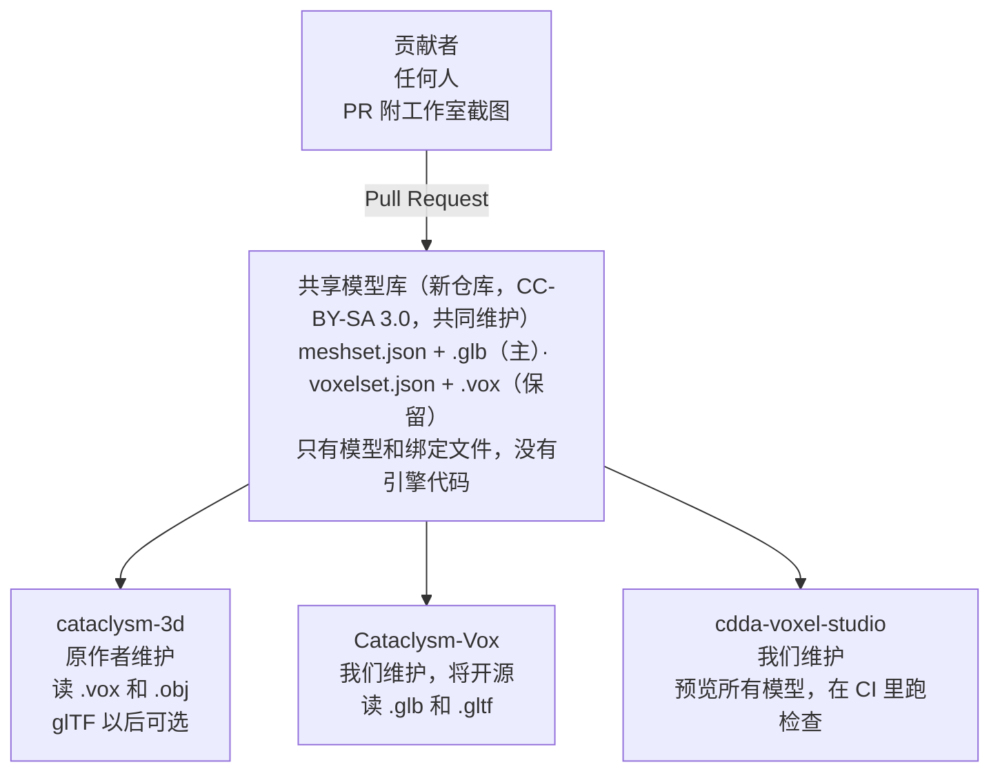

# CDDA 共享 3D 模型库提案（中文版）

2026-11-17

> 本文是英文提案的中文对照，用于核对内容；发给 cataclysm-3d 作者的是英文版。

## 摘要

我们提议建一个按开放授权发布的 CDDA 共享 3D 模型库，供两个各自独立维护的引擎使用：**cataclysm-3d** 和 **Cataclysm-Vox**。库里只放模型和绑定配置，不放任何引擎代码。每个引擎读取自己支持的部分；共用的浏览器工具 **cdda-voxel-studio** 负责按游戏尺度预览和检查每个模型。

- **授权：** CC-BY-SA 3.0，与 CDDA 本体和 CDDA-Tilesets 一致。
- **格式：** 今后以 glTF（`.glb`）网格为主，因为角色需要骨骼、动画和贴图。现有的 `.vox` 模型继续支持。
- **风格：** 方块感低多边形末日生存风（blocky low-poly zombie survival）。
- **第一步：** 先一起维护模型，不要求任何一方修改引擎。

## 为什么用网格（glTF）

角色要继续发展，就得靠 glTF：一个文件就能装下几何体、骨骼、命名动画、贴图或顶点色，并且采用真实世界单位。`.vox` 模型装不下骨骼和贴图，生物只能靠每帧一个文件来做动画。

- **骨骼和动画：** 用一套共享的人形骨骼，所有玩家、NPC 和丧尸都能复用同一套 Idle / Walk / Attack / Death 动画，并穿戴同一套服装。
- **贴图或顶点色：** 保持方块感的同时，表面能看出是木头、金属还是皮肤。
- **开放标准：** Blender、three.js 和大多数引擎都能读写 glTF；C/C++ 的读取库（如 cgltf）只有一个文件。
- **已经在跑：** Cataclysm-Vox 现在就用 glTF 渲染整张 CDDA 地图：外观登记表里有 81 个 glTF 模型，带动画的蒙皮生物，实例化的道具。cdda-voxel-studio 现在能在 `.vox` 旁边预览 `.glb`、`.gltf` 和 `.obj`，并检查尺寸、三角形数、贴图和动画名。

cataclysm-3d 已有的 `.obj` 路径对静态道具仍然有用；glTF 补上的是 `.obj` 装不下的东西。

## 角色与仓库

每个项目保留自己的维护者和发布节奏，只有模型库是共享的。参与进来不需要任何人修改自己的引擎。



- **共享模型库：** 新建仓库，共同维护。存放模型、`meshset.json`、`voxelset.json` 和署名。
- **cataclysm-3d：** 由原作者维护，读取它目前支持的格式（`.vox`、`.obj`）。
- **Cataclysm-Vox：** 由我们维护，将会开源，渲染 glTF。
- **cdda-voxel-studio：** 由我们维护，预览和检查每个模型，并在 PR 上运行检查。

## 授权

库里所有模型按 **CC-BY-SA 3.0** 发布，与 CDDA 和 CDDA-Tilesets 相同。授权必须在第一个外部贡献到来之前定下，因为之后再改需要每个贡献者都同意。

- **逐文件署名：** 每个模型都写明作者、授权和来源，写在它的素材集条目里（`author`、`license`、`source`），或放在旁边的 `CREDITS.md` 里。
- **贡献者确认：** 每个 PR 都声明作品是贡献者本人创作的（或注明来源），并按 CC-BY-SA 3.0 发布（PR 模板里的勾选框，或 DCO 签名）。
- **兼容的外部素材** 可以保留署名后收入，比如 CC0 素材包（Kenney、Quaternius、KayKit）和 CC BY 素材包。
- **一律不收：** 商业游戏的模型、贴图或提取物，禁止商用（NC）或禁止修改（ND）的素材，以及从它们派生的任何东西。

## 技术规范

尺度沿用 cataclysm-3d 现有的设定：1 个模型单位 = 1 格 = 1 米，墙高 2 格，人高 1.625 格。以下其余内容都是草案，由双方维护者共同修改。

| 项目 | 规则 |
| --- | --- |
| 单位 | 1 单位 = 1 格 = 1 米。在 Blender 里按米建模，尺寸就是对的。 |
| 坐标轴 | +Y 向上，−Z 朝北（glTF 默认）。MagicaVoxel 模型保持 +Y 朝北。 |
| 原点 | 模型底部中心，立在地面上。 |
| 文件类型 | 新网格用 `.glb`（二进制 glTF 2.0）；`.vox` 继续接受。不使用 Draco 等压缩扩展。 |
| 一个文件一个对象 | 每个文件一个模型（变体另存为单独文件），按它对应的 CDDA id 或内置类型命名。 |
| 命名 | 小写 `snake_case`；变体加 `_a`、`_b`；体素动画帧命名为 `idle_0`、`idle_1`。 |
| 目录 | `terrain/`、`furniture/`、`items/`、`monsters/`、`characters/`、`vehicles/`、`effects/`。 |
| 可染色模型 | 用白色或灰度制作，引擎可以乘上对象的 CDDA 颜色（`tint`）。 |
| 光照 | 不烘焙光照、阴影或环境光遮蔽，光照交给引擎。 |

### 三角形预算（参考，不强制）

超过下列数值时工作室会提示，但不会拦下贡献。

| 类别 | 三角形数 |
| --- | --- |
| 物品和小道具 | ≤ 1,000 |
| 家具 | ≤ 2,000 |
| 角色和生物 | ≤ 5,000 |
| 载具（整车） | ≤ 10,000 |

作为参照：DEADWOOD — Last Light 手工制作的武器每件约 100–800 个三角形。

### 共享人形骨骼

玩家、NPC 和人形怪物共用一套精简骨骼，动画和服装在它们之间通用。建议的骨骼（约 19 根）：

`root` › `hips` › `spine` › `chest` › `neck` › `head`；每侧 `upper_arm`、`forearm`、`hand`；每侧 `thigh`、`shin`、`foot`（后缀 `.L` / `.R`）。

其他生物（四足动物、鸟、昆虫）保留各自的骨骼，只统一动画名。

### 动画

每个有动画的生物至少提供四个动画，名称必须完全一致：`Idle`、`Walk`、`Attack`、`Death`。`Death` 只播放一次，并停在最后一帧。欢迎提供更多动画，并在素材集条目里列出。

## meshset.json（格式第 1 版）

`meshset.json` 是素材库和各个引擎之间唯一的约定：它像 `voxelset.json` 把 CDDA 对象绑定到 `.vox` 文件一样，把对象绑定到网格文件，并增加摆放字段。引擎忽略它不认识的字段；新增字段时提升 `format_version`。

```json
{
  "name": "CDDA shared meshes",
  "format_version": 1,
  "models": [
    { "id": "mon_zombie", "file": "monsters/zombie.glb", "height": 1.7,
      "animations": { "idle": "Idle", "walk": "Walk", "attack": "Attack", "death": "Death" },
      "author": "name", "license": "CC-BY-SA-3.0" },
    { "builtin": "chair", "files": ["furniture/chair_a.glb", "furniture/chair_b.glb"], "fit": 0.8, "rotY": 90 }
  ]
}
```

| 字段 | 含义 |
| --- | --- |
| `id`、`builtin`、`material`、`file`、`files` | 绑定方式，与 `voxelset.json` 完全相同。查找顺序：精确 id，然后 `looks_like` 链，最后内置类型。 |
| `scale` | 在「1 单位 = 1 格」基础上的缩放系数。 |
| `fit` | 缩放到水平最长边占这么多格。优先于 `scale`。 |
| `height` | 缩放到模型有这么多格高。优先于 `fit` 和 `scale`。 |
| `rotX`、`rotY`、`rotZ` | 旋转角度（度），在测量尺寸之前应用。 |
| `lieFlat` | 放倒（绕 X 轴 −90°）：用于竖着建模的长条物品。 |
| `offset` | 摆放之后的 `[x, y, z]` 偏移，单位是格；y 向上。 |
| `preserveOrigin` | 保留文件自身的原点，不自动贴地、居中到格子上。 |
| `hide` | 要隐藏的节点名子串。 |
| `tint`、`emissive`、`rotates`、`random_rotation` | 含义与 `voxelset.json` 相同。 |
| `animations` | 每个状态对应的 glTF 动画名：`idle`、`walk`、`attack`、`death`。 |
| `author`、`license`、`source` | 这个条目所用文件的署名信息。 |

工作室已经能读这个格式（`format_version` 和署名字段除外，它会原样保留），并检查每个模型的尺寸、三角形数、贴图和动画名。

## 美术方向

素材库的整体风格是 **方块感低多边形末日生存风**（blocky low-poly zombie survival）：棱角分明的厚实形体，面数少，真实世界比例，在游戏的俯视和斜视镜头下剪影清晰可辨。颜色和贴图暂时不限制，等模型多到可以比较时再定规范。

- **形体：** 以方块和带倒角的块体为主，少用光滑曲面；小于约 10 厘米的细节省略，或直接画在颜色上。
- **比例：** 真实世界比例，按上面的尺度；不做 Q 版或大头。
- **一眼可辨：** 每个对象在工作室的斜视和俯视下，都必须能凭剪影认出来。
- **暂不限制：** 调色板、顶点色还是贴图、贴图分辨率。

### 参考：DEADWOOD — Last Light 的武器

[DEADWOOD — Last Light](https://github.com/cedricbernadac/deadwood-open)（Cédric Bernadac 基于 three.js 制作的开源浏览器丧尸生存 FPS）的武器很好地体现了目标风格：

- [`public/frisson/weapons.glb`](https://github.com/cedricbernadac/deadwood-open/blob/main/public/frisson/weapons.glb)：手枪、霰弹枪、冲锋枪、突击步枪、狙击枪、马格南、加特林、火箭筒、火焰喷射器、球棒、锤子、消防斧、武士刀。
- 在 Blender 里为该游戏制作；只用顶点色，没有贴图；每件约 100–800 个三角形；真实尺寸（球棒 1.01 米，武士刀 1.33 米，狙击枪 1.06 米）。
- 用同一套几何体渲染的 [HUD 剪影](https://github.com/cedricbernadac/deadwood-open/tree/main/public/hud-silhouettes) 说明这些形体在很小的尺寸下依然清晰可辨。

它的媒体素材按 CC BY 4.0 授权（[ASSETS.md](https://github.com/cedricbernadac/deadwood-open/blob/main/ASSETS.md)）；署名写法：*"DEADWOOD — Last Light" by Cédric Bernadac, CC BY 4.0*。我们只把它当作风格参考；是否把它的模型直接收入素材库，列在下面的待确认问题里。

## 体素模型

`.vox` 和 glTF 并存，网格优先，体素模型逐步替换而不是直接删除。cataclysm-3d 现在能用的东西都不会失效。

1. 现有的 `.vox` 模型和 `voxelset.json` 保持原样。
2. 新模型做成 `.glb`，在 `meshset.json` 里绑定。
3. 同时支持两种格式的引擎：有网格就用网格，没有就用体素模型。
4. 某个对象的网格模型做得足够好之后，经双方同意，可以把它的 `.vox` 模型从库里撤下。

## 贡献流程

贡献以 PR 形式提交到素材库仓库，先由工作室自动检查，再由维护者审核。

1. Fork 素材库，加入模型，并在 `meshset.json`（或 `voxelset.json`）里加上它的条目和署名。
2. 在 cdda-voxel-studio 里打开它，绑定到对应的 CDDA 对象，把斜视截图附在 PR 上。
3. CI 运行工作室的检查：文件能加载、贴地、尺寸合理、三角形预算、动画名齐全。
4. 维护者对照参考模型审核风格和可辨识度，然后合并。

审核清单：

- [ ] 每个文件都有署名和授权
- [ ] 尺度：1 单位 = 1 米，立在地面上，朝北（−Z）
- [ ] 在三角形预算以内，或说明了超出的理由
- [ ] 有动画的生物提供 `Idle`、`Walk`、`Attack`、`Death`
- [ ] 人形角色使用共享骨骼
- [ ] 在斜视和俯视下都能认出来

覆盖率表（哪些 CDDA id 已经有模型）由工作室的「无模型」过滤结果生成，贡献者可以从中挑还缺的来做。内置类型（`zombie`、`wall`、`tree` 等）优先，因为每个都能覆盖大量对象。

## 请 cataclysm-3d 作者确认的问题

- [ ] CC-BY-SA 3.0 是否合适？还是更倾向 CC-BY-SA 4.0（3.0 可以单向升级到 4.0）？
- [ ] 入门素材集里的 `.vox` 模型能否在保留署名的前提下迁入共享库？
- [ ] 上面的共享人形骨骼，是否适合 cataclysm-3d 以后可能做的动画？
- [ ] `meshset.json` 应该和 `voxelset.json` 放在同一个素材集文件夹里，还是单独一个文件夹？
- [ ] 你是否希望 cataclysm-3d 将来读取 glTF？这不是本提案的前提。
- [ ] 素材库仓库放在哪里？除了我们，还有谁应该有合并权限？
- [ ] DEADWOOD — Last Light 的武器是 CC BY 4.0：我们只把它当参考，还是去问它的作者，能否在保留署名的前提下改编进 CC-BY-SA 素材库？
